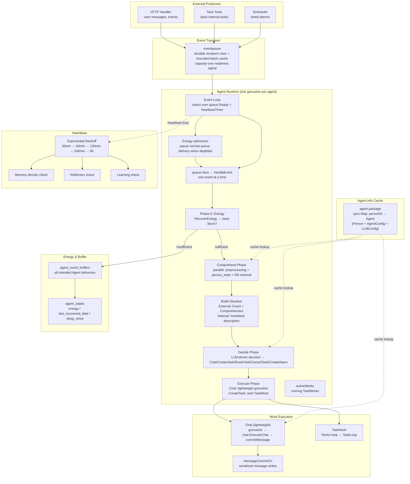
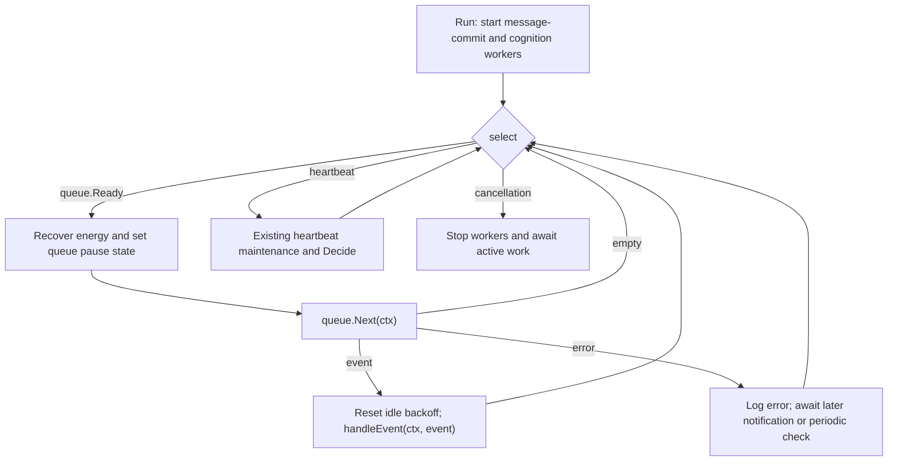
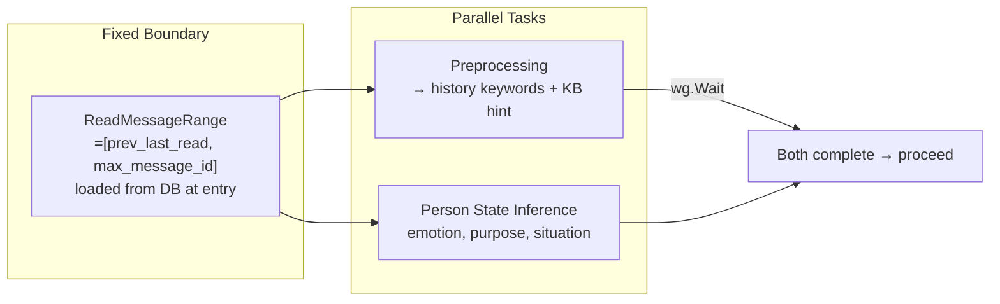
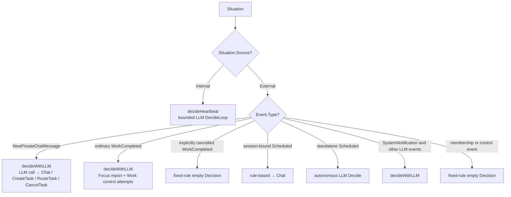
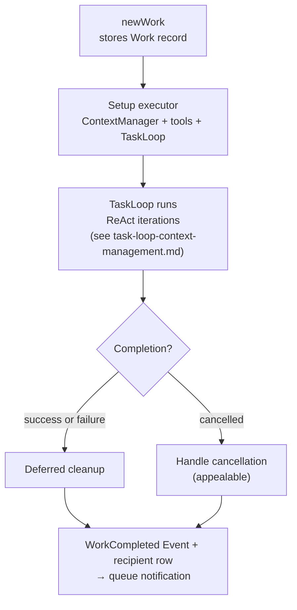
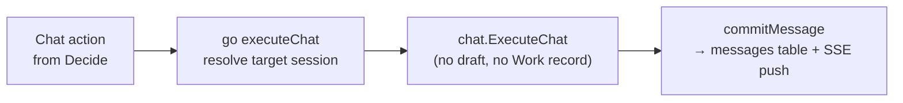
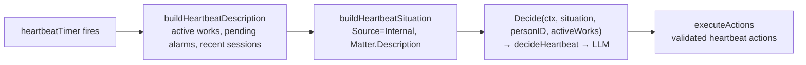
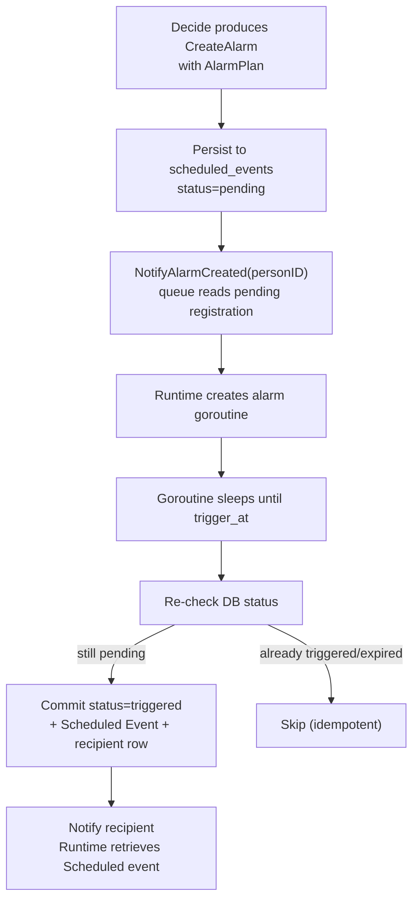
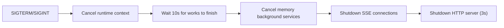

# Agent Runtime: Event Loop & Work Lifecycle — Engineering Implementation

This document describes how the agent runtime processes incoming events, transitions between Comprehend→Situation→Decide→Execute phases, and manages the lifecycle of Work (Task) and lightweight Chat actions. It also covers the energy budget system, the event-buffer recovery mechanism, and the agent info cache.

## Architecture Overview



The runtime is a global singleton (`globalRuntimeManager` in manager.go). Each agent gets one `agentRuntime` with a dedicated goroutine running an event loop. The event loop processes decision opportunities serially; accepted Chat and Focus actions can continue asynchronously while later events are considered.

## Agent Info Cache (`service/agent`)

The `agent` package caches Person, AgentConfig, and LLMConfig together to eliminate repeated DB queries on the hot path:

```go
type Agent struct {
    Person model.Person
    Config model.AgentConfig
    LLM    model.LLMConfig
}
```

- `agent.GetAgent(personID)` — loads from `sync.Map` cache; falls back to DB on miss.
- `agent.Refresh(personID)` — invalidates cache entry via async channel. Called from API handlers on CreateAgent / UpdateAgent / DeleteAgent / UpdateLLMConfig.

Usage principle: **fetch at point of use, don't hold or pass the pointer**. Each function that needs agent data calls `agent.GetAgent` itself. Passing `*Agent` between functions risks stale data if `Refresh` fires mid-flight (e.g., during an LLM call).

## Event Loop

The event loop runs in a dedicated goroutine per Agent. Runtime determines whether its energy permits normal delivery; queue internals own SQL, batches, positions, and removal. Alarm registration remains available even while normal delivery is paused.



`Ready` is a coalesced signal, not an event channel. `Next` does not wait for future events: it returns `(event, nil)`, `(nil, nil)` when empty, or `(nil, err)` on failure, cancellation, or subscription stop. Database access may wait for a connection or I/O under the caller's context. Runtime returns to `select` after each event, retaining heartbeat and cancellation opportunities.

### `handleEvent` — unified event entry

`handleEvent(ctx, event) bool` retains the existing Comprehend, Observation, Decide, and action behavior. Control-only `AlarmCreated` arms its scheduled record and returns without an Observation or Decision. The queue has already removed a normal event's buffer row before returning it; this method's boolean result is not a queue acknowledgement.

### Event handling flow

1. **Phase 0 — Energy**: Runtime uses `energy.RecoverEnergy(personID)` before `Next` and pauses ordinary retrieval when energy is insufficient. Pending rows remain in storage. `handleEvent` rechecks energy at the business boundary; if it has become insufficient, it retains the event through `eventqueue.AppendTx`, records `sleep_since` if empty, and returns false. No independent replay loop is used.

2. **Observation creation**: After Comprehend, the runtime records the triggering durable Event and the exact Message Events it read. A message already consumed by an earlier batch already has its Observation; a buffered or unread message is not observed. An outgoing Message receives the sender's Observation when its Message and Event are committed.

3. **Batched message skip**: For `NewPrivateChatMessage`, if `last_read_message_id >= payload.MessageID`, the message was consumed by an earlier batch — return early.

4. **Comprehend**: Routes by Event type and returns a `Comprehension`. Chat comprehension can run preprocessing and person-state inference concurrently. See [context-engineering-pipeline.md](./context-engineering-pipeline.md).

5. **Build Situation**: The runtime assembles a `Situation` with `Source`, general `Subject` and `Environment`, and event-specific `Matter.Event` and `Matter.Comprehension`. It is the unified input to Decide.

6. **Decide**: `Decide(ctx, situation, personID, activeWorks)` produces a `DecisionResult`. LLM-driven paths may inspect authorized history in a bounded, read-only DecideLoop before calling the `decide` tool. Fixed-rule paths retain their direct behavior.

7. **Persist cause and read boundary**: An accepted Decision and its Actions are persisted with the triggering Event relationship; for a chat batch, `last_read_message_id` advances to `ReadMessageRange[1]` in the same transaction. A rejected or failed decision does not advance that boundary.

8. **Energy deduction**: If `len(Actions) > 0`, deduct energy. Cost depends on `Situation.Source` (External=1, Internal=5).

9. **Execute**: Each action is dispatched:
   - `Chat`: launches `go executeChat(ctx, situation, chatPlan)` — lightweight goroutine, no Work created
   - `CreateTask`: `newWork(situation, workPlan)` creates a TaskWork, adds to `activeWorks`
   - `RouteTask` / `CancelTask`: sends directive via `guidanceCh` to an existing active TaskWork
   - `CreateAlarm`: persists `ScheduledEvent` and registers alarm goroutine

### Event type routing

| Event Type | Source | Handling |
|---|---|---|
| `NewPrivateChatMessage` | Another person sends a message | Energy check → Batch-skip check → Comprehend → record exact Observations → Situation → Decide → persist Decision, Actions, and read boundary → DeductEnergy → Execute |
| `WorkCompleted` | Work finishes (Focus loop) | Energy check → Remove from activeWorks → Comprehend the result report → Situation → LLM Decide with recent experience and Work control attempts → DeductEnergy → Execute. Explicitly cancelled Work takes a fixed-rule empty Decision. |
| `Scheduled` | Alarm fires | Session-bound alarm: rule-based Chat; standalone alarm: autonomous LLM Decide. A configured `send_message` alarm uses its direct delivery path. |
| `AlarmCreated` | Pending scheduled record | AlarmRegistry registers goroutine → return; independent of normal delivery energy admission |
| `GroupChatJoined` / `GroupChatLeft` | Session membership changes | Fixed-rule empty Decision |
| `SystemNotification` | World notification | Comprehend → Situation → LLM Decide |

Fast-path (`Scheduled` + `ActionSendMessage`) bypasses Comprehend/Decide entirely and writes the pre-computed message directly. Per "Decide-phase-only" energy rule, fast-path and `AlarmCreated` do not deduct energy.

## Energy System

The energy system gives each agent a finite daily response budget.

### State

Persisted in the `agent_states` table, keyed by `person_id`:

| Field | Type | Description |
|---|---|---|
| `person_id` | int64 | FK to `persons` table, unique index |
| `energy` | int | Current energy, range `[0, 200]`, default 100 |
| `last_recovered_date` | text | `"YYYY-MM-DD"` in the global fixed timezone |
| `sleep_since` | text | RFC3339 timestamp marking sleep onset; empty when awake |

### Constants

| Constant | Value | Meaning |
|---|---|---|
| `MaxEnergy` | 200 | Energy cap at any moment |
| `DailyRecovery` | 100 | Energy granted per day |
| `CostPassive` | 1 | Cost per external-event-triggered Decide |
| `CostActive` | 5 | Cost per heartbeat-triggered Decide |

### Global fixed timezone

Energy recovery is date-based. `world.InitTime()` reads the persisted timezone from `<DATA_ROOT>/tz.txt` before runtime startup; `world.Now()`, `world.Today()`, and `world.Timezone()` provide the shared world clock.

### Recovery (`RecoverEnergy`)

Called at the start of every `handleEvent` and once during `createAgentRuntime` startup. Lazily applies daily recovery: if `last_recovered_date != today`, add `days * 100` energy, capped at `MaxEnergy`, and update `last_recovered_date`.

### Deduction (`DeductEnergy`)

Called after Decide, only when `len(Actions) > 0`. Deducts `cost` from energy, never lets it go negative.

### Prompt injection

- **Static rules** (in `decidePromptTemplate`): daily budget, carry-over, 200 cap, cost per response.
- **Dynamic suffix** (`buildEnergyDynamicSuffix`): current time, remaining energy, cost hint. Adds warnings at low thresholds (≤15 / ≤5).

### Situation source → cost mapping

| Source | Cost | When |
|---|---|---|
| `SituationSourceExternal` | 1 | Decide triggered by an eventqueue event |
| `SituationSourceInternal` | 5 | Decide triggered by a heartbeat |

## Durable Event Queue & Startup Reads

`agent_event_buffers` records all intended Agent deliveries when their Event is produced, including deliveries whose Runtime is absent or energy-depleted. The producer commits its Event and recipient rows in one transaction, then calls `eventqueue.Notify` with Person IDs. `(person_id, event_id)` is unique while a delivery remains pending; enqueue creates no Observation.

### Buffer storage

| Field | Type | Description |
|---|---|---|
| `id` | int64 | Monotonic delivery ID used for deterministic queue order |
| `person_id` | int64 | Intended Agent identity |
| `event_type` | int | Runtime event type |
| `session_id` | int64 | Associated Session, or zero for person-level events |
| `event_id` | int64 | Associated durable Event |
| `payload_json` | text | Typed payload and optional originating Action context |

### Bounded retrieval and removal

Each subscription has one current batch of at most 64 records, one consumption index, an in-memory delivery position, and a capacity-one readiness signal. There is one serial `Next` consumer. Producers and periodic checks only signal; they do not mutate the cache. When the current batch is exhausted, `Next` queries later delivery IDs in ascending order. It returns the available rows without waiting to fill the batch.

Batch loading leaves all rows in the database. For each normal event, `Next` decodes the current cached row, deletes only that buffer row, then clears the slot, advances the position, signals another consumption opportunity, and returns the event. Query, decoding, or deletion failure returns an error without advancing the position; a failed current entry is retained for retry. Batching reduces payload queries, but each successful retrieval still performs a database delete. No connection or transaction remains held during business processing.

This is removal on retrieval, without status fields or ACK. A process interruption after deletion commits, including before `Next` returns or before Runtime finishes handling it, does not restore the record. Queue removal proves neither Observation nor Decision nor Action completion. Event and business history are preserved. Runtime's existing explicit energy and graceful-shutdown retention can enqueue a new pending copy; the queue does not infer processing progress from Decisions or Observations.

### Wake-ups, controls, and restart

Subscription startup signals readiness immediately. Every successful retrieval signals again so cached events and later batches remain accessible. Producers use nonblocking, coalesced notifications after commit. Queue-side checks every 30 seconds compensate for missed notifications and provide later retry opportunities without an immediate error loop. `nil, nil` is a valid result for stale signals or an empty queue.

Startup and resubscription use a fresh cache and position to read the remaining database rows. Teardown cancels the subscription's periodic worker without closing a readiness channel that producers might still reference. No Runtime-owned replay list or persistent position is needed.

Pending `scheduled_events` are the durable source for control-only alarm registration. Startup, `NotifyAlarmCreated`, and periodic checks request registration reads inside the queue. A subscription tracks which pending alarm IDs it has handed to Runtime for registration; a new subscription starts this control position afresh so timer registration can be recovered. Runtime's alarm module still owns arming, firing, and cancellation.

Development revision 3 merges equivalent historical buffer duplicates while retaining Session and Action context, then adds recipient/Event uniqueness and the Person/delivery-ID index. Conflicting duplicate payloads stop conversion rather than discard history. It does not synthesize deliveries for unrelated historical Events.

## Comprehend Phase

For chat Events, Comprehend runs preprocessing and person-state inference concurrently after fixing the unread message boundary. For full details, see [context-engineering-pipeline.md](./context-engineering-pipeline.md).



For `NewPrivateChatMessage`, Comprehend loads unread messages in the fixed `ReadMessageRange`, returns their exact IDs, and provides a bounded observed same-session window. Non-message Events use their event-specific comprehension path without the chat-specific inference pipeline.

## Situation — Unified Decide Input

Between Comprehend and Decide, the runtime builds a `Situation` DTO that is the sole cognitive input to Decide:

```go
type Situation struct {
    Source  SituationSource  // External (event) or Internal (heartbeat)
    Subject SituationSubject // Energy, ongoing work/actions, and bounded recent experience
    Environment SituationEnvironment // General sessions, people, and resources
    Matter  SituationMatter  // Event + Comprehension (external) or Description (internal)
}
```

**External path**: `event + direct Comprehension + general Subject and Environment → Situation → Decide`

**Internal (heartbeat) path**: `heartbeat self-observation → buildHeartbeatSituation → Decide`

The heartbeat does NOT go through Comprehend and does NOT create a fake event. It observes runtime facts (active works, pending alarms, recent conversations) and writes a natural-language description into `Matter.Description`. `Matter.Event` and `Matter.Comprehension` remain nil. Heartbeat and external-event Situations construct the same general `Subject` and `Environment`; the recent experience in `Subject` is not limited to the triggering Session.

## Decide Phase



### Action types

| Action | Semantics | Implementation |
|---|---|---|
| `Chat` | Send a chat message. Does NOT create a Work. | `go executeChat()` → `chat.ExecuteChat` → `commitMessage`. ChatPlan carries guidance + session target. |
| `CreateTask` | Start a new multi-step TaskWork with ReAct loop. | `newWork()` creates Work, starts goroutine via `go w.Run(ctx)`. |
| `RouteTask` | Route to an existing active TaskWork. | Directive sent via `guidanceCh`. Only routes to TaskWork. |
| `CancelTask` | Request an active TaskWork to stop. | Appealable — not forceful. Directive via `guidanceCh`. |
| `CreateAlarm` | Set a future alarm. | Persists `ScheduledEvent`, registers alarm goroutine. |

### ChatPlan — delivery target encoding

Chat actions carry a `ChatPlan` that encodes the delivery target:

```go
type ChatPlan struct {
    Guidance          string // Internal intention, first-person
    SessionID         int64  // >0: existing session; -1: new 1v1 session; 0: illegal
    RecipientPersonID int64  // Required when SessionID == -1
}
```

- `SessionID > 0` — send to the specified existing session.
- `SessionID == -1` — create a new 1v1 session with `RecipientPersonID`.
- `SessionID == 0` — always illegal (Go zero value, indistinguishable from missing field in LLM JSON).

`UseNewSession()` helper: `return plan.SessionID < 0`.

### Decision validation (`filterValidActions`)

- Actions referencing non-existent or completed works are dropped.
- Route/Cancel without a matching active TaskWork are dropped.
- Route/Cancel targeting a non-TaskWork are dropped.
- Chat actions with `session_id == 0` are dropped (illegal).
- Chat actions with `session_id == -1` must have valid `recipient_person_id`.
- If all actions are filtered out, the agent takes no action.

### Sessions context injection

The general `Situation.Environment` provides a bounded roster of accessible sessions, contactable people, and resources. It does not preload every conversation or EntityProfile. `Situation.Subject` also carries a bounded chronological view of this agent's earlier observed Events, subsequent Decisions, and recorded Action effects across Sessions. It excludes the current Event and does not treat an Action's intention as a completed effect. The triggering chat's direct Comprehension can include a small observed same-session window; the DecideLoop can inspect other authorized history and a known entity's current profile on demand. This lets the LLM choose a session target without treating unobserved messages as memories.

An ordinary `WorkCompleted` event includes a bounded excerpt of the Focus output or says that no result was reported. Its Decide input also queries recent Route/Cancel attempts by that Work's ID, including attempts with no accepted control effect. The triggering message remains subject to Observation and source-access checks. The Focus report is evidence of what the executor reported, not independent proof that the requested goal was achieved.

### `trigger` field — causal semantic description

`buildTriggerContext` renders the earlier Action's recorded background and reason when an Event carries `TriggerAction`; Decide receives this as a causal clue. Message history and other source records still follow their own Observation and access checks.

## Work Lifecycle

### TaskWork

The only Work type. A ReAct loop that runs tools to accomplish a goal:



- Uses TaskLoop for ReAct execution (see [task-loop-context-management.md](./task-loop-context-management.md))
- Supports Guidance (directive injection from Decide) and Cancel (appealable)
- `runTask` fetches agent info via `agent.GetAgent` at the point of use, then passes `LLMConfig` and `PersonID` to `task.RunTask`

### Chat — lightweight action

Chat is NOT a Work. It is a lightweight goroutine that calls `chat.ExecuteChat` and commits the result directly:

It is nevertheless a persistent Action: its Decision records why it was chosen, and its Action can be shown as ongoing until the asynchronous execution ends. Active Works and active Actions answer different questions; neither replaces the other.



- No Work record, no draft, no `WorkCompleted` event.
- `executeChat` fetches agent info via `agent.GetAgent` right before calling `chat.ExecuteChat`.
- Message commits are serialized through `messageCommitCh`.

### Active works management

- `activeWorks` holds only TaskWorks (Chat actions don't create works).
- `hasActiveWorkInSession(sessionID)` checks whether any active work targets the given session.
- Works are removed from `activeWorks` when their `WorkCompleted` event is processed.

## Heartbeat System

The heartbeat uses exponential backoff starting from `heartbeatBase` (30min). Each subsequent idle heartbeat doubles the interval, capped at `heartbeatMax` (6h):

```
tick 1 → 30min, tick 2 → 60min, tick 3 → 120min, tick 4 → 240min, tick 5+ → 360min
```

Any external event resets `idleTicks` to 0, restarting from 30min.

### Heartbeat → Decide flow

Heartbeats do NOT go through Comprehend or the event queue. The flow is:



Heartbeat Decide may choose Chat, CreateAlarm, UpdateBio, EnterPrivateSpace, SendJinshu, InspectOwnedSpace, or WaitForExecutionSlot. It cannot start, route, or cancel a Focus Work directly.

### Heartbeat checks

| Check | Frequency | What it does |
|---|---|---|
| `checkMemoryDensity` | Every 6 ticks | Triggers EntityProfile generation when observation density crosses threshold |
| `checkReflection` | Every tick | Scans notes.jsonl for new insights |
| `checkLearning` | Every tick (with in-progress guard) | Discovers public experiences worth adopting |

## Alarm System

Alarms implement the `CreateAlarm` action — the agent asks to be woken at a specific time:



- Each alarm is a goroutine tracked in `alarmRegistry`.
- On runtime restart, `recoverScheduledEvents` restores all pending alarms.
- `AlarmCreated` events are handled before the energy check — they register the alarm goroutine and return immediately.

## Startup & Recovery

1. **`world.InitTime()`**: load the world timezone from `<DATA_ROOT>/tz.txt`.
2. **Reset participant sessions**: all AI `participant_sessions` with `status=working` reset to `idle`.
3. **Recover active works**: `recoverActiveWorks` marks running works as `Abandoned`, resets participant status.
4. **Start agent runtimes**: one `agentRuntime` per `agent_config`. Each runtime calls `energy.RecoverEnergy(personID)` at construction.
5. **Recover scheduled events**: `recoverScheduledEvents` restores pending alarms.
6. **Read pending deliveries**: subscription startup signals `Ready`; Runtime retrieves one event at a time through `Next`, using the same path as normal delivery.

### Work recovery

Abandoned works are marked `abandoned` and their participant sessions reset to `idle`. Works are not resumable after a crash — TaskWorks leave state in notes.jsonl and workspace files, so the agent can re-read context on the next task.

## Configuration

| Config | Description | Default |
|---|---|---|
| `heartbeatBase` | First heartbeat interval after an external event | 30 min |
| `heartbeatMax` | Maximum heartbeat interval (exponential backoff cap) | 6 h |
| `energy.MaxEnergy` | Energy cap at any moment | 200 |
| `energy.DailyRecovery` | Energy granted per day | 100 |
| `energy.CostPassive` | Cost per external-event-triggered Decide | 1 |
| `energy.CostActive` | Cost per heartbeat-triggered Decide | 5 |

## Shutdown



The 10-second grace period allows in-progress TaskWorks to reach a natural stopping point. Chat goroutines are lightweight and complete quickly.
