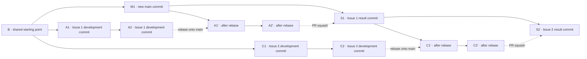

# Git and Delivery: Issue -> main

`main` is the project's only long-lived integration branch. Each Issue defines a coherent result that can be reviewed, verified, and safely integrated. A temporary branch delivers it directly to `main` through a PR; there are no long-lived feature branches. The result may be a feature, fix, migration, or infrastructure change. Issues may belong to the same release or larger initiative, but those groupings do not change branch targets or lifetimes.

## Branches and Integration

- Create a temporary delivery branch for each Issue from the latest `main`, for example `issue/123-short-description`. Its final PR contains only that Issue and the supporting changes it needs, not unrelated work.
- Define Issue scope by whether the final result is coherent, verifiable, and safe to integrate. Split overly broad work along independently deliverable boundaries. If it must be delivered as one unit, stages may be developed and verified within the same Issue branch.
- Normally use one Issue branch, with as many intermediate commits as the developer needs. Local child branches are allowed when useful, but no nested branch structure or separate PR for every internal stage is required. The Issue branch still carries the complete final result. Its owner coordinates contributors, synchronizes with `main`, resolves conflicts, verifies the result, and submits the PR.
- Rebase an active branch onto the latest `main` reasonably promptly when `main` receives new commits. Coordinate before rewriting the history of a pushed branch shared with others. Use `--force-with-lease` only for that branch; never force-push `main`.
- After every rebase, inspect the new business logic on `main` for conflicts, overlap, or behavior that supersedes the current Issue. If a semantic conflict appears, pause the affected work and discuss the requirement boundary. A successful rebase or passing tests cannot replace this review.
- Before starting an Issue and after each rebase, follow [local data snapshot and restore](local_data.md) for the entire data directory so local verification starts again from the latest released version's migration baseline.
- Before submitting a PR, fetch the latest remote `main` and rebase the delivery branch onto it, even if the branch was synchronized earlier. Resolve conflicts during the rebase; do not merge `main` into the branch or use another update method that creates unnecessary merge commits. Then inspect the final diff and run relevant checks. If `main` changes during review, reassess compatibility and rebase again when needed. After updating the PR branch, confirm that verification results and review comments still apply to the final diff.
- Merge the PR into `main` using **Squash and merge**, producing one result commit per Issue. Intermediate commits and local child branches do not enter `main`. Diagnosis and reverts operate at the Issue-delivery level. Delete the temporary branch after merge; start later work from the new `main`.
- Do not merge a requirement branch directly into `main` outside a PR. Enforce review, checks, and merge permissions with repository protection rules when needed, rather than relying only on a written convention.

### Example Branch History

The diagram shows two Issues merged in sequence using the usual single-level Issue branches. Letters represent commits. It combines states before and after operations; it is **not a `git log` snapshot**. Solid arrows represent actual parent-child commit relationships. Dashed arrows represent rebase or squash operations, not Git parent relationships.

The Issue 1 branch replays its development commits after `M1`, and its PR then produces `S1`. While Issue 2 is being developed, `main` gains `S1`. After Issue 2 rebases onto it, its PR produces `S2`. Thus `main` retains two result commits, one per Issue; intermediate commits from either branch do not enter mainline history.

## Before Starting and Before Committing

- Inspect the working tree before making changes. Identify existing staged and unstaged edits; they may belong to another task. Do not overwrite, revert, or include them in this delivery without authorization.
- Establish the latest released version as the baseline for describing the change. Internal stages, experimental paths, and corrections during development do not automatically become user-facing release changes.
- Before committing, review the relevant diff for consistency across implementation, migrations, tests, documentation, configuration, and frontend mappings. Check for missing comments, debug output, and generated files.

## Change Descriptions and Release Membership

- A commit message starts with a recognizable result. Its body explains the main behavior and necessary technical boundaries. The squash commit on `main` must independently describe the final Issue result, not copy an arbitrary intermediate commit.
- `CHANGELOG.md` records changes users can experience or need to know about, in language they can understand. Internal refactoring and intermediate development corrections are not listed one by one.
- Release design documents describe requirements, responsibilities, data boundaries, implementation choices, and acceptance methods. Update them when implementation changes the design; do not leave an obsolete plan as development guidance.
- The public `doc/` directory explains behavior that is released or ready for release. Preserve theoretical explanations and historical context that remain correct; revise invalid descriptions and explain new capability boundaries.
- Track the release membership of multiple Issues through Issues, PRs, release plans, and release records, not through an additional feature branch. Code entering `main` before its release must remain safe alongside existing functionality. A branch name cannot hide an incomplete state.

## Delivery Checks

- Run appropriate automated checks for deterministic behavior. For model-dependent behavior, record the scenario, input, output, and log source, distinguishing missing context from model choice.
- Accept the complete Issue result before merging and confirm that it remains safe with the latest `main`. A squash only cleans up history; it does not replace functional or compatibility verification.
- State which checks were completed and which require manual work or longer observation. Do not describe "not reproduced" as "fixed," or treat "the database contains a record" as proof that "the agent saw it."
